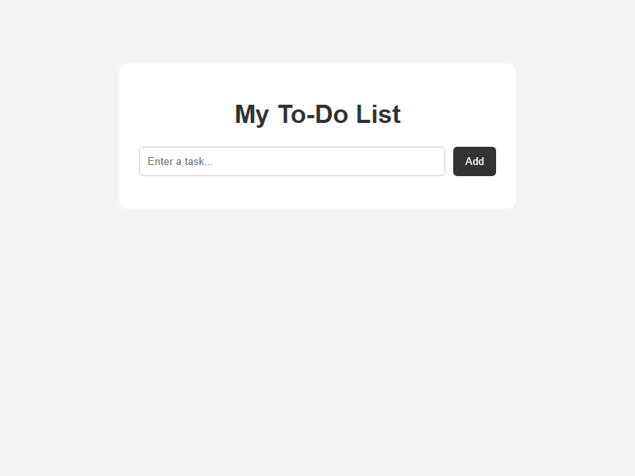
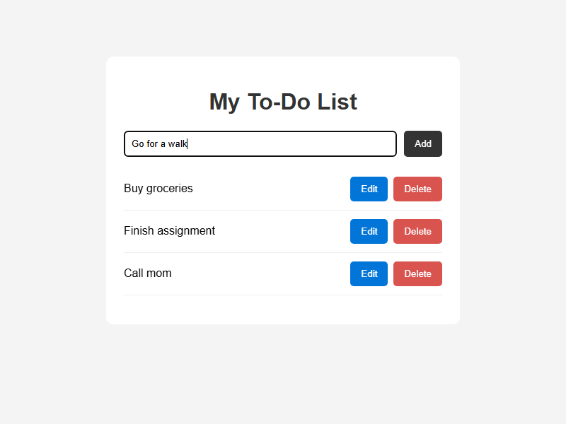
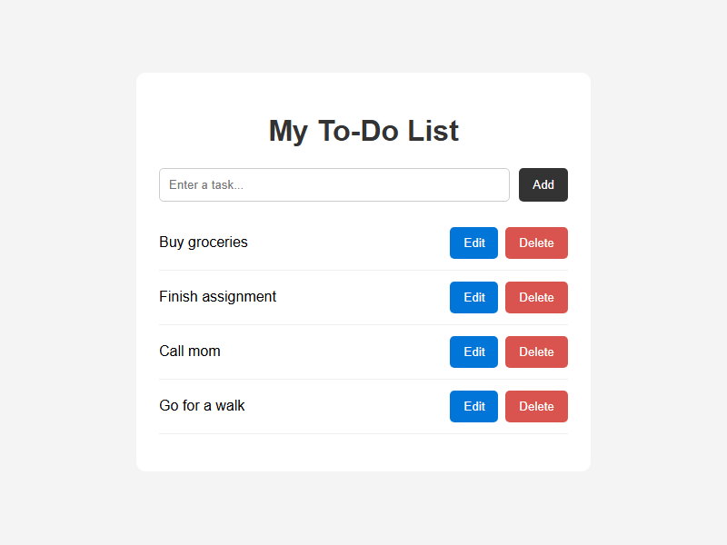
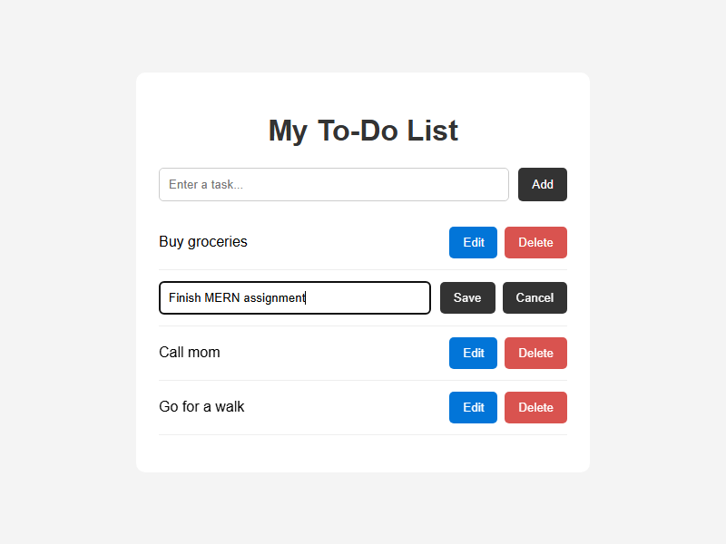
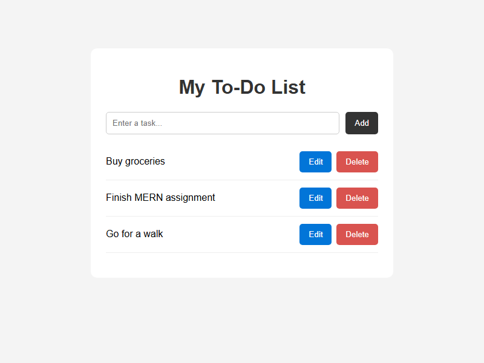

# MERN To-Do List

A basic to-do list app built with MongoDB, Express, React and Node.js. You can add, view, edit and delete tasks.

## Screenshots

**Empty list**



**Adding a task**



**Task list**



**Editing a task**



**After deleting a task**



## How to run

1. Install [MongoDB Community Server](https://www.mongodb.com/try/download/community) and make sure it is running.
2. Create `todo-app/backend/.env` with:
   ```env
   MONGO_URI=mongodb://127.0.0.1:27017/todoDB
   ```
3. Start the backend:
   ```bash
   cd todo-app/backend
   npm install
   npm run dev
   ```
4. In a second terminal, start the frontend:
   ```bash
   cd todo-app/frontend
   npm install
   npm run dev
   ```
5. Open http://localhost:5173
